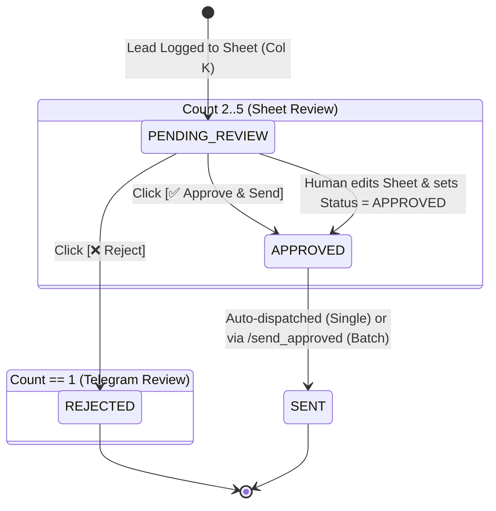

# 🛡️ Human-in-the-Loop (HITL) Workflow & Database Schema

Inspired by CRM status-driven automation patterns (`kaymen99/sales-outreach-automation-langgraph`), the agent **never sends cold emails automatically**. Every generated pitch requires explicit human verification before dispatch.

---

## 1. Adaptive Approval Routing (1 Lead vs. 2–5 Leads)

Reviewing a single lead in chat is fast, whereas reviewing 5 multi-line pitches in Telegram becomes cluttered. The agent adapts its review interface based on the selected lead count:

### Path A: Single Lead (`Count == 1`) — Telegram-Level Review

1. The enriched lead and 3-line pitch are appended to Google Sheets with `Status = PENDING_REVIEW`.
2. Telegram presents a review card displaying the lead's **Name**, **Role**, **Profile URL**, **Email**, **Phone**, **Score**, and **Draft Pitch**.
3. **Action Options:**
   - **`[ ✅ Approve & Send ]`:** Updates Column K to `APPROVED`, dispatches the email immediately, and marks Column K as `SENT`.
   - **`[ ❌ Reject ]`:** Updates Column K to `REJECTED` without sending any email.

### Path B: Batch Leads (`Count == 2..5`) — Sheet-Level Review

1. All discovered leads (`2` to `5`) are logged to Google Sheets with `Status = PENDING_REVIEW`.
2. Telegram replies with a compact summary listing the logged row numbers, names, roles, and extracted emails.
3. **Human Review Step:**
   - Open the **`GoPratle_BDR_Leads`** Google Sheet.
   - Review or edit the generated pitches in **Column I (`3-Line Pitch`)**.
   - Change **Column K (`Status`)** from `PENDING_REVIEW` to `APPROVED` for the rows you want to contact.
   - Run `/send_approved` in Telegram to dispatch all approved rows in one batch.

---

## 2. 12-Column Google Sheet Schema (`GoPratle_BDR_Leads`)

The `gspread` integration reads and writes strictly by column index (`1` to `12`). Ensure **Row 1** of your Google Sheet matches this exact column order:

|     Col     | Index | Sheet Header       | Python Variable (`AgentState`) | Default / Fallback Value                                                                |
| :---------: | :----: | :----------------- | :------------------------------- | :-------------------------------------------------------------------------------------- |
| **A** | `1` | `Company`        | `state["company"]`             | Parsed target company (e.g., `Capgemini`)                                             |
| **B** | `2` | `City`           | `state["city"]`                | Parsed target city (e.g., `Mumbai`)                                                   |
| **C** | `3` | `Lead Name`      | `state["lead_name"]`           | Full name or `<Company> Management Desk`                                              |
| **D** | `4` | `Role`           | `state["lead_role"]`           | Job title or `Venue / Operations Manager`                                             |
| **E** | `5` | `profile_url`    | `state["profile_url"]`         | LinkedIn/source URL or `Not publicly mentioned`                                       |
| **F** | `6` | `Email`          | `state["email"]`               | Extracted email or `Not publicly mentioned`                                           |
| **G** | `7` | `phone_number`   | `state["phone_number"]`        | Extracted phone or `Not publicly mentioned`                                           |
| **H** | `8` | `Score`          | `state["qualification_score"]` | Formatted as `<score>/10` (e.g., `8/10`)                                            |
| **I** | `9` | `3-Line Pitch`   | `state["pitch"]`               | Personalized 3-line GoPratle outreach copy                                              |
| **J** | `10` | `Follow-up Copy` | `state["follow_up"]`           | 2-line follow-up message for 3 days later                                               |
| **K** | `11` | `Status`         | Workflow State                   | `PENDING_REVIEW` $\rightarrow$ `APPROVED` $\rightarrow$ `SENT` / `REJECTED` |
| **L** | `12` | `Follow-UP At`   | Follow-up Schedule               | `Pending Approval` (updated upon send)                                                |

---

## 3. Data Integrity & Safety Rules

1. **Zero Hallucinated Contacts:** The extractor prompt strictly forbids guessing emails or phone numbers. If an email or phone number is not explicitly present in the web snippet, the agent records `"Not publicly mentioned"`.
2. **Company-Scoped Deduplication (`get_existing_leads(company)`):**
   - Before searching, the agent filters existing Sheet rows by **Column A (`Company`)**.
   - It collects known **Lead Names (Col C)** and **Profile URLs (Col E)** for that specific company so repeat searches for the same company only surface net-new decision-makers, without blocking searches for new companies.
3. **Sandbox Email Routing (`send_approved_leads`):**
   - During testing, if an approved lead's email is `"Not publicly mentioned"`, the email dispatcher routes the test message to `TEST_RECIPIENT` so you can verify formatting and delivery safely while preserving the real extracted status in the Sheet.
