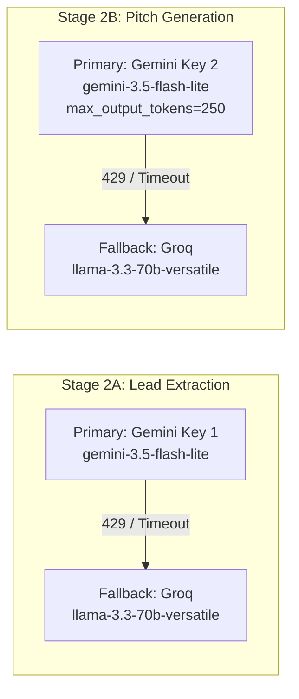

# ⚡ Token Optimization, Multi-Source Search & Resilience

## 1. Stage-by-Stage Token Consumption & Optimization

In a multi-lead BDR pipeline (`1` to `5` leads × up to `3` source retries), raw web search results are the largest token consumer. Below is where tokens are spent and how each stage is optimized:

| Pipeline Stage                                           |   Token Share   | Primary Bottleneck                                        | Optimization Applied                                                                                                                                                                                                                                    |
| :------------------------------------------------------- | :-------------: | :-------------------------------------------------------- | :------------------------------------------------------------------------------------------------------------------------------------------------------------------------------------------------------------------------------------------------------ |
| **Stage 1: Input Parser (`stage1_bot.py`)**      | **0–5%** | Parsing free-form chat messages                           | **2-Tier Hybrid Parser:** 0-token Regex fast-path for `"for <company> in <city>"`; falls back to ~50-token `gemini-3.5-flash-lite` call only for casual phrasing.                                                                             |
| **Stage 2A: Extraction (`extract_and_qualify`)** | **~75%** | 5 raw Tavily web results + deduplication list per attempt | **Payload Pruning (`prune_search_results`):** Disables raw HTML (`include_raw_content=False`), slices titles to `120` chars and snippets to `300` chars (**~65% token reduction**), and limits prompt history to the last 15 names. |
| **Stage 2B: Copywriting (`generate_pitch`)**     | **~20%** | Thinking-token overhead & verbose output                  | **Lightweight Flash-Lite + Hard Cap:** Uses `gemini-3.5-flash-lite` with `max_output_tokens=250` on a dedicated second API key.                                                                                                               |
| **Stage 3: CRM & UI (`stage3_actions.py`)**      |  **0%**  | Direct REST API calls                                     | Handled natively in Python via `gspread` and `python-telegram-bot`.                                                                                                                                                                                 |

---

## 2. Dual-Key LLM Architecture & Automatic Failover

To double Requests Per Minute (RPM) and Tokens Per Minute (TPM) quotas while preventing `429 Too Many Requests` or `400 tool_use_failed` crashes, LLM calls are split across two independent API keys with automatic Groq failover:

### Key Resilience Guards

- **Structured Output Fallbacks (`.with_fallbacks`):** Both `structured_extractor` and `structured_writer` wrap `ChatGoogleGenerativeAI` with a `ChatGroq` backup bound to the exact same Pydantic schema (`LeadEvaluation` / `OutreachCopy`).
- **Exhausted Candidate Guard:** If all candidates in a search snippet are already contacted (which previously caused `groq.BadRequestError: tool_use_failed`), the `try...except` block inside `extract_and_qualify()` catches the exception and cleanly returns `lead_name = "NOT_FOUND"`.

---

## 3. 4-Source Search Rotation (`search_lead`)

Relying only on LinkedIn misses local venues, clubs, hospitality groups, and public contact numbers. The agent rotates across 4 distinct Tavily query patterns:

|      Index      | Channel Name                  | Target Platforms & Query Focus                                                            | Best For                                                |
| :-------------: | :---------------------------- | :---------------------------------------------------------------------------------------- | :------------------------------------------------------ |
| **`0`** | **LinkedIn Profiles**   | `site:linkedin.com/in "<company>" <city> Events OR HR OR Admin OR Marketing OR Manager` | Corporate HR, Workplace, and Event Heads                |
| **`1`** | **LinkedIn & Web**      | `"<company>" <city> linkedin Manager OR Director OR Head OR Founder OR Operations`      | Senior leadership and regional directors                |
| **`2`** | **Maps & Directories**  | `"<company>" <city> contact email phone manager banquet events`                         | Justdial, IndiaMART, venue websites, public phone/email |
| **`3`** | **Event & PR Mentions** | `"<company>" <city> event launch corporate hospitality manager`                         | Press releases, brand launches, and experiential leads  |

### How Rotation Works Across Batch Runs

- **Within a single lead search (`retries = 0..2`):** If source `0` returns `NOT_FOUND`, a duplicate, or a score `< 5`, the conditional router (`route_after_qualification`) automatically increments `retries` and queries the next channel (`(source_index + retries) % 4`).
- **Across a batch (`count = 2..5`):** `main.py` passes `source_index = i` on each loop iteration so Lead #1 starts on LinkedIn Profiles, Lead #2 starts on LinkedIn & Web, Lead #3 starts on Maps & Directories, and Lead #4 starts on Event & PR Mentions.

---

## 4. Brand-Alias Matching & Venue Fallback

1. **Brand-Alias Recognition:**
   - Users often type abbreviations (`TCS`, `Bikaner`) while web profiles list full legal names (*Tata Consultancy Services*, *Bikanervala*).
   - `extract_and_qualify()` explicitly instructs Gemini to match common brand aliases and parent-company names rather than rejecting them as unrelated.
2. **Management Desk Fallback (`Score: 6/10`):**
   - Clubs, banquet halls, and regional outlets (e.g., `GCC Club`) often publish official contact pages or directory listings without naming an individual employee.
   - Instead of returning `NOT_FOUND`, the extractor logs **`<Company> Management Desk`** (`Role: Venue / Operations Manager`, `Score: 6/10`) along with any public email, phone number, and directory URL found in the snippet.
3. **Early Batch Stop & Pacing:**
   - A `1.5s` async pause (`await asyncio.sleep(1.5)`) spaces out batch iterations to prevent burst rate limits.
   - If a full 3-source rotation returns `NOT_FOUND`, the batch loop breaks immediately to avoid wasting Tavily and Gemini quota on exhausted queries.
